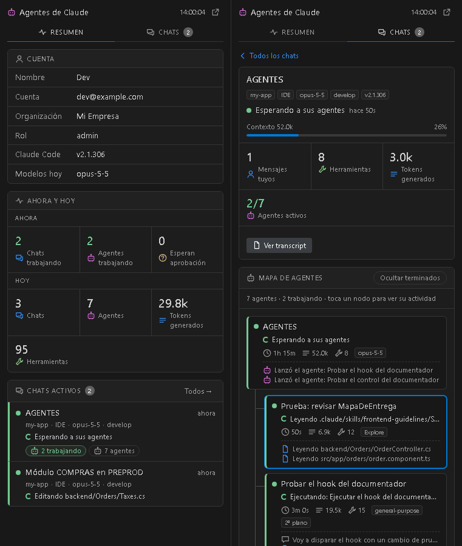
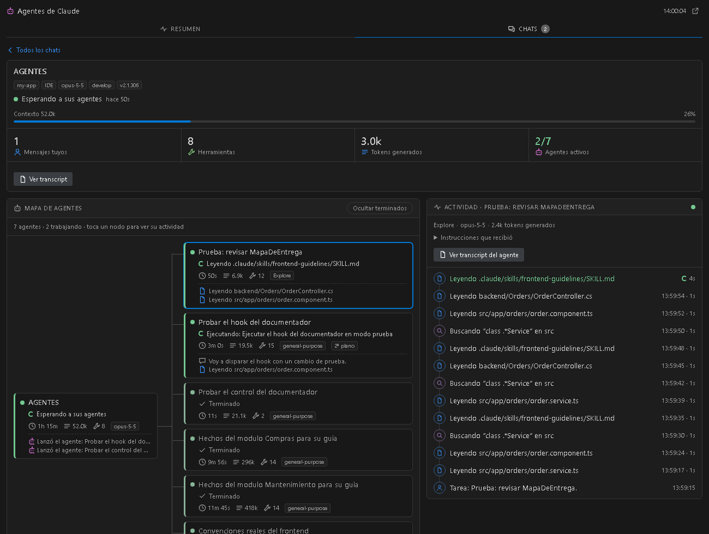

# Agentes de Claude

[English](README.md) · **Español**

Extensión para **VS Code** (y Cursor u otros editores compatibles) que muestra **en tiempo real** tus chats de [Claude Code](https://docs.anthropic.com/en/docs/claude-code) y lo que está haciendo cada agente y subagente, sin tener que entrar a cada uno.

No usa red ni hooks, y no modifica nada: solo lee los archivos que Claude Code ya guarda en tu disco.



## Qué muestra

- **Resumen**
  - Tu cuenta: nombre, correo, organización, versión de Claude Code y modelos usados hoy.
  - **Ahora**: chats trabajando, agentes trabajando, chats que esperan tu aprobación.
  - **Hoy**: chats, agentes, tokens generados y herramientas usadas.
  - Los chats activos. Toca uno para entrar.
- **Chats**: los que están trabajando o todos los de las últimas 24 h.
- **Dentro de un chat**
  - **Mapa de agentes**: el agente principal conectado a cada subagente, con su estado, lo que hace en este momento ("Leyendo src/app.ts", "Ejecutando: npm test"), duración, tokens y herramientas.
  - **Actividad**: la bitácora en vivo del nodo que elijas, con un ícono por tipo de acción, la hora y la duración de cada paso, las instrucciones que recibió el agente y un botón para abrir su transcript.
  - **Tareas**: la lista de tareas (`TodoWrite`) del chat, si existe.
- **Barra de estado**: `⟳ 2 chats · 3 agentes`. Se pone amarilla si un chat parece esperar tu aprobación.
- **Pestaña del editor**: con el botón ↗ el panel se abre a pantalla completa, con el mapa de izquierda a derecha y la actividad al costado.



Usa los colores de tu tema de VS Code, así que se ve bien en temas claros, oscuros y de alto contraste.

## Requisitos

- VS Code 1.85 o posterior (o Cursor).
- [Claude Code](https://docs.anthropic.com/en/docs/claude-code) instalado y usado en esa máquina, ya sea desde la terminal o desde la extensión del IDE.

## Instalación

1. Descarga el archivo `.vsix` de la última versión en [Releases](../../releases).
2. Instálalo de una de estas formas:
   - En VS Code: vista de **Extensiones** → menú **`···`** (arriba a la derecha) → **Install from VSIX…** → elige el archivo.
   - Desde la terminal:

     ```sh
     code --install-extension claude-agents-panel-0.2.0.vsix
     ```

3. Recarga la ventana (`Ctrl+Shift+P` → **Developer: Reload Window**).

Aparece un ícono nuevo en la barra de actividades de la izquierda y el texto "Claude" en la barra de estado.

### Remote SSH, WSL y contenedores

La extensión está marcada como `"extensionKind": ["workspace"]`, así que corre del lado donde están tus archivos, que es donde Claude Code guarda `~/.claude`. Instálala **estando conectado al remoto**. Si en la vista de Extensiones aparece instalada solo en "Local", usa **Install in SSH: …**.

### Actualizar

Instala el `.vsix` nuevo encima del anterior y recarga la ventana. Los datos del panel se actualizan solos cada 2 segundos. El botón ⟳ fuerza una lectura inmediata.

## Ajustes

| Ajuste | Por defecto | Descripción |
|---|---|---|
| `claudeAgents.language` | `auto` | Idioma del panel: `auto` (el de VS Code), `en` o `es`. |
| `claudeAgents.claudeDir` | vacío | Directorio de Claude Code. Vacío = `$CLAUDE_CONFIG_DIR` o `~/.claude`. |
| `claudeAgents.pollSeconds` | `2` | Cada cuántos segundos se releen los transcripts (solo los bytes nuevos). |
| `claudeAgents.statsSeconds` | `20` | Cada cuántos segundos se recalculan los totales de hoy. |

## Comandos

| Comando | Qué hace |
|---|---|
| **Agentes de Claude: Abrir panel** | Muestra el panel en la barra lateral. |
| **Agentes de Claude: Abrir en pestaña del editor** | Abre el panel a pantalla completa. |
| **Agentes de Claude: Actualizar ahora** | Fuerza una lectura inmediata. |

## Cómo funciona

Claude Code escribe en disco todo lo que hace cada chat y cada subagente. La extensión lee esos archivos y deduce el estado:

| Archivo | Qué se saca de ahí |
|---|---|
| `~/.claude/projects/<proyecto>/<sesión>.jsonl` | Cada chat: mensajes, herramientas, tokens, llamadas a `Agent`/`Task`. |
| `~/.claude/projects/<proyecto>/<sesión>/subagents/agent-<id>.jsonl` + `.meta.json` | Cada subagente y todo lo que hace. |
| `~/.claude.json` → `oauthAccount` | Nombre, correo y organización. **No lee tokens ni credenciales.** |

En cada pasada relee **solo los bytes nuevos** de los archivos del chat que tienes abierto. El estado se deduce de la última entrada:

- una herramienta sin resultado significa **trabajando**;
- un texto final significa **terminado**;
- el aviso de fin que envía Claude Code marca como terminados a los agentes en segundo plano.

Los detalles están en [docs/ARQUITECTURA.md](docs/ARQUITECTURA.md).

```text
extension.js        registra el panel, la pestaña del editor, la barra de estado y el sondeo
lib/reader.js       lector incremental de un transcript + estado derivado
lib/sessions.js     descubre chats y subagentes (lee inicio y final de cada archivo)
lib/snapshot.js     arma el objeto que ve el panel: cuenta, hoy, chats y detalle del chat abierto
lib/describe.js     traduce herramientas a frases ("Leyendo …", "Buscando …")
lib/i18n.js         textos en inglés y español del lado del host
lib/util.js         utilidades (rutas, lectura de cabeza/cola, fechas)
webview/            HTML/CSS/JS del panel, sin dependencias
scripts/demo.js     datos falsos para probar sin Claude Code
```

## Privacidad

- Todo ocurre en tu máquina. No hay red, telemetría ni servicios externos.
- Solo lee archivos. Nunca escribe en `~/.claude`.
- De `~/.claude.json` solo lee los datos de perfil de `oauthAccount`.
- "Ver transcript" solo abre archivos `.jsonl` que estén dentro del directorio de Claude.

## Desarrollo

Solo necesitas Node.js 18 o posterior. No hay dependencias que instalar.

```sh
git clone https://github.com/BLOPA1/vscode-claude-agents.git
cd vscode-claude-agents
node scripts/demo.js salida/    # crea datos falsos y genera salida/overview.html y salida/detail.html
                                # (DEMO_LANG=es para verlo en español)
npm run package                 # genera el .vsix
```

- **Probar en el editor:** abre la carpeta en VS Code y pulsa **F5**. Se abre una ventana *Extension Development Host* con la extensión cargada.
- **Cambiar el aspecto:** todo está en `webview/panel.css` (usa las variables de color del tema) y `webview/panel.js`.
- **Agregar o corregir una traducción:** los textos del host están en `lib/i18n.js`, los del panel al inicio de `webview/panel.js` y los del manifiesto en `package.nls.json` / `package.nls.es.json`.
- **Probar sin tener agentes corriendo:** el demo genera un `~/.claude` falso en la carpeta de salida y nunca toca tus datos reales.

## Limitaciones

- Depende del formato interno de los transcripts de Claude Code, que no es una interfaz pública. Una actualización de Claude Code puede romper partes del panel.
- "¿Esperando tu aprobación?" es una suposición: una herramienta sin resultado por más de 30 s se ve igual que una lenta.
- VS Code no informa qué pestaña de chat tiene el foco, así que el panel no puede saltar a ese chat dentro de Claude Code. Sí puede abrir su transcript.
- Los sub-subagentes (agentes lanzados por un subagente) se cuentan, pero no se dibujan como un nivel extra del árbol.
- La interfaz está en inglés y español. Por defecto usa el idioma de VS Code; se puede forzar con el ajuste `claudeAgents.language`.

## Créditos y licencia

La técnica de leer los transcripts locales viene de [karin-lin/claude-code-panel](https://github.com/karin-lin/claude-code-panel) (MIT). `lib/util.js` y partes de `lib/sessions.js` están basadas en ese proyecto.

Licencia [MIT](LICENSE). Este proyecto no está afiliado a Anthropic. "Claude" y "Claude Code" son marcas de Anthropic.
