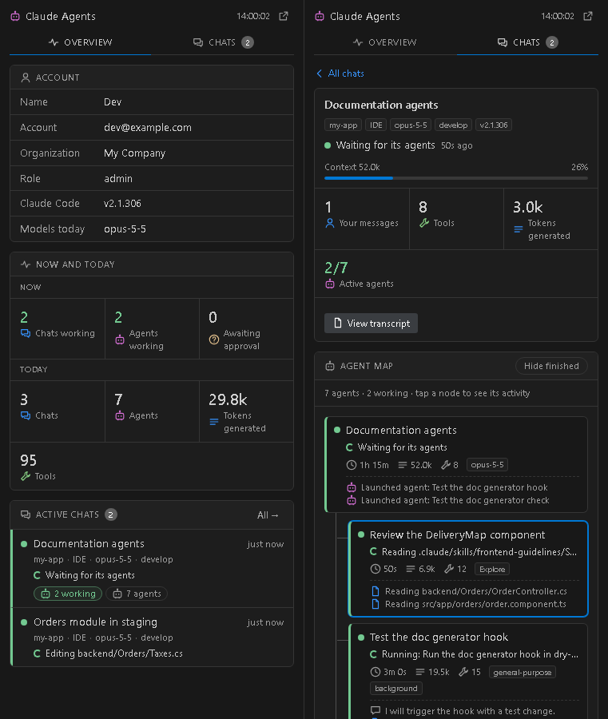
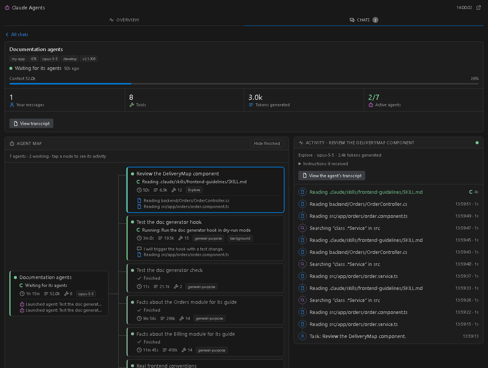

# Claude Agents

**English** · [Español](README.es.md)

A **VS Code** extension (also works in Cursor and other compatible editors) that shows your [Claude Code](https://docs.anthropic.com/en/docs/claude-code) chats **in real time**, and what each agent and subagent is doing, without opening them one by one.

It doesn't use the network or hooks, and it doesn't change anything. It only reads the files Claude Code already writes to your disk.



## What it shows

- **Overview**
  - Your account: name, email, organization, Claude Code version and the models used today.
  - **Now**: chats working, agents working, and chats awaiting your approval.
  - **Today**: chats, agents, tokens generated and tools used.
  - The active chats. Click one to open it.
- **Chats**: the ones working now, or all of them from the last 24 hours.
- **Inside a chat**
  - **Agent map**: the main agent connected to each subagent, with its status, what it is doing right now ("Reading src/app.ts", "Running: npm test"), duration, tokens and tools.
  - **Activity**: a live log for the node you pick, with an icon per kind of action, the time and duration of each step, the instructions the agent received and a button to open its transcript.
  - **Tasks**: the chat's task list (`TodoWrite`), if it has one.
- **Status bar**: `⟳ 2 chats · 3 agents`. It turns yellow when a chat seems to be waiting for your approval.
- **Editor tab**: the ↗ button opens the panel full size, with the map running left to right and the activity beside it.



It uses your VS Code theme colors, so it looks right in light, dark and high-contrast themes. The interface is available in **English and Spanish**.

## Requirements

- VS Code 1.85 or later (or Cursor).
- [Claude Code](https://docs.anthropic.com/en/docs/claude-code) installed and used on that machine, from the terminal or from the IDE extension.

## Installation

1. Download the `.vsix` file of the latest version from [Releases](../../releases).
2. Install it in one of these ways:
   - In VS Code: **Extensions** view → **`···`** menu (top right) → **Install from VSIX…** → pick the file.
   - From a terminal:

     ```sh
     code --install-extension claude-agents-panel-0.2.0.vsix
     ```

3. Reload the window (`Ctrl+Shift+P` → **Developer: Reload Window**).

A new icon appears in the activity bar on the left, and "Claude" appears in the status bar.

### Remote SSH, WSL and containers

The extension is marked `"extensionKind": ["workspace"]`, so it runs on the side where your files are, which is where Claude Code keeps `~/.claude`. Install it **while connected to the remote**. If the Extensions view shows it installed only under "Local", use **Install in SSH: …**.

### Updating

Install the new `.vsix` over the old one and reload the window. The panel data refreshes by itself every 2 seconds, and the ⟳ button forces an immediate read.

## Settings

| Setting | Default | Description |
|---|---|---|
| `claudeAgents.language` | `auto` | Panel language: `auto` (same as VS Code), `en` or `es`. |
| `claudeAgents.claudeDir` | empty | Claude Code directory. Empty = `$CLAUDE_CONFIG_DIR` or `~/.claude`. |
| `claudeAgents.pollSeconds` | `2` | How often, in seconds, the transcripts are re-read (new bytes only). |
| `claudeAgents.statsSeconds` | `20` | How often, in seconds, today's totals are recalculated. |

## Commands

| Command | What it does |
|---|---|
| **Claude Agents: Open panel** | Shows the panel in the sidebar. |
| **Claude Agents: Open in an editor tab** | Opens the panel full size. |
| **Claude Agents: Refresh now** | Forces an immediate read. |

## How it works

Claude Code writes to disk everything each chat and each subagent does. The extension reads those files and works out the status:

| File | What it provides |
|---|---|
| `~/.claude/projects/<project>/<session>.jsonl` | Each chat: messages, tools, tokens, `Agent`/`Task` calls. |
| `~/.claude/projects/<project>/<session>/subagents/agent-<id>.jsonl` + `.meta.json` | Each subagent and everything it does. |
| `~/.claude.json` → `oauthAccount` | Name, email and organization. **It never reads tokens or credentials.** |

On each pass it re-reads **only the new bytes** of the files for the chat you have open. The status comes from the last entry:

- a tool without a result means **working**;
- a final text means **finished**;
- the completion notice Claude Code sends marks background agents as finished.

The details are in [docs/ARCHITECTURE.md](docs/ARCHITECTURE.md).

```text
extension.js        registers the panel, the editor tab, the status bar and the polling
lib/reader.js       incremental reader for a transcript + derived status
lib/sessions.js     finds chats and subagents (reads the start and end of each file)
lib/snapshot.js     builds the object the panel shows: account, today, chats, open chat detail
lib/describe.js     turns tool calls into phrases ("Reading …", "Searching …")
lib/i18n.js         English and Spanish strings for the host side
lib/util.js         helpers (paths, reading file heads and tails, dates)
webview/            the panel's HTML/CSS/JS, no dependencies
scripts/demo.js     fake data to try it without Claude Code
```

## Privacy

- Everything happens on your machine. There is no network, telemetry or external service.
- It only reads files. It never writes to `~/.claude`.
- From `~/.claude.json` it only reads the profile data in `oauthAccount`.
- "View transcript" only opens `.jsonl` files inside the Claude directory.

## Development

You only need Node.js 18 or later. There are no dependencies to install.

```sh
git clone https://github.com/BLOPA1/vscode-claude-agents.git
cd vscode-claude-agents
node scripts/demo.js out/       # creates fake data and writes out/overview.html and out/detail.html
                                # (DEMO_LANG=es for Spanish)
npm run package                 # builds the .vsix
```

- **Try it in the editor:** open the folder in VS Code and press **F5**. An *Extension Development Host* window opens with the extension loaded.
- **Change the look:** everything is in `webview/panel.css` (it uses the theme's color variables) and `webview/panel.js`.
- **Add or fix a translation:** host strings live in `lib/i18n.js`, panel strings at the top of `webview/panel.js`, and manifest strings in `package.nls.json` / `package.nls.es.json`.
- **Test without running agents:** the demo creates a fake `~/.claude` in the output folder and never touches your real data.

Code comments are in Spanish.

## Limitations

- It depends on the internal format of Claude Code transcripts, which is not a public interface. A Claude Code update may break parts of the panel.
- "Awaiting your approval?" is a guess: a tool with no result for more than 30 s looks the same as a slow one.
- VS Code doesn't tell extensions which chat tab has focus, so the panel can't jump to that chat inside Claude Code. It can open its transcript.
- Sub-subagents (agents launched by a subagent) are counted but not drawn as an extra level of the tree.

## Credits and license

The technique of reading the local transcripts comes from [karin-lin/claude-code-panel](https://github.com/karin-lin/claude-code-panel) (MIT). `lib/util.js` and parts of `lib/sessions.js` are based on that project.

[MIT](LICENSE) license. This project is not affiliated with Anthropic. "Claude" and "Claude Code" are trademarks of Anthropic.
